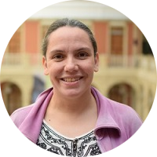

### What is this course about?

This course is intended for [people](personas.qmd) who use spreadsheets for data manipulation and have never programmed, but would like to learn how to work with R. Therefore its starts from the beginning: why use R? and where to start?

We propose to work with R in an orderly and reproducible way. For this reason, we present a workflow that allows those who take this course to apply good programming practices, work collaboratively and present their work in a single document that includes the analysis and the results.

Whenever we can, we will mention how what we propose to solve with R can also be done with spreadsheets and the advantages and disadvantages of each approach.

In each section we include activities along with examples. We want these exercises to be realistic so that anyone can find similarities in their own data and can apply what they have learned to other situations.

### Before we start

During this workshop we will use Posit Cloud.  If you want to use your computer we will use R and RStudio. Please [follow these instructions to prepare for the workshop](prepare.qmd).

### Schedule

This is a tentative time table. 

|Duration (minutes) |Topics|
|:---|----------|
|55  | [Introduction, reports, workflows](01-introduction.qmd) |
|5   | Break |
|55  | [Reading](02-reading-data.qmd) and [Plotting](03-plotting-data.qmd) |
|5   | Break |
|30  | [Data manipulation](04-data-manipulation.qmd) |
|20  | [Reporting your work](05-reports.qmd) |
|10 | Q&A and goodbye |

### Who are we? 

**Yanina Bellini Saibene**

Yanina Bellini Saibene is the Community Manager at [rOpenSci](https://ropensci.org). She was a researcher at Argentina's National Institute of Agricultural Technology (INTA) from 1998 to 2022, working on AgTech. She also develops software to support research and education. She teaches undergraduate and graduate courses at several universities in Argentina, teaching applied Data Science and developing open courses and tutorials to teach technical data management skills. She is a trainer, instructor and member of the Board of Directors of [The Carpentries](https://carpentries.org/), and a [Posit](https://education.rstudio.com/trainers/people/bellini_saibene+yanina/) certified instructor. She is part of the Board of Directors of R-Ladies+ Global.

[yabellini.netlify.app](https://yabellini.netlify.app/)

**Pao Corrales**

Paola Corrales holds a PhD in Atmospheric Sciences from the University of Buenos Aires. She worked in atmospheric sciences applying data assimilation techniques to improve short-term forecasts of severe weather events in Argentina, and she currently works at Monash University exploring weather and climate extremes in Australia. She is a trainer and instructor for [The Carpentries](https://carpentries.org/) and an [RStudio](https://education.rstudio.com/trainers/people/corrales+paola/) certified instructor. She has also contributed to translation projects of The Carpentries' materials, the book Teaching Tech Together and R base. She is part of Expedición Ciencia, an Argentina-based non-profit organization, where she leads educational projects such as science camps and workshops for students and primary and secondary school science teachers. She is a professor in the Data Science degree at Universidad Austral. She also develops openly licensed materials to teach and learn R from scratch.

[paobcorrales.github.io](https://github.com/paocorrales) | [@paobcorrales](https://fosstodon.org/@paocorrales)

**Elio Campitelli**

Elio Campitelli holds a PhD in Atmospheric Sciences from the University of Buenos Aires, where they studied the large-scale circulation of the Southern Hemisphere. They currently study the interaction between the atmosphere and Antarctic sea ice at Monash University. As part of their research, they have developed several R packages to work with climate science data, such as metR, ggnewscale, icecdr and others.

[eliocamp.github.io](https://github.com/eliocamp) | [@eliocamp](https://mastodon.social/@eliocamp)

___

#### License

 
All materials in this course are under the license <a rel="license" href="https://creativecommons.org/licenses/by-sa/4.0/deed.es_ES">Creative Commons Attribution-ShareAlike 4.0 International License</a>.

We are inspired and based on the following resources:

* [R for Reproducible Scientific Analysis](https://swcarpentry.github.io/r-novice-gapminder/) by The Carpentries

* [R for Excel Users](https://rstudio-conf-2020.github.io/r-for-excel/) by Dr. Julie Stewart Lowndes and Dr. Allison Horst

* [R for Data Science](https://r4ds.had.co.nz/) by Hadley Wickham

* [de Excel a R](https://paocorrales.github.io/deExcelaR/) by Paola Corrales and Elio Campitelli

* [An Antarctic Tour of the Tidyverse](https://silvia.rbind.io/talk/2020-08-31-tour-of-the-tidyverse/) by Silvia Canelón

The source code for these materials and web page can be found at https://github.com/yabellini/fromSpreadSheetToR.
